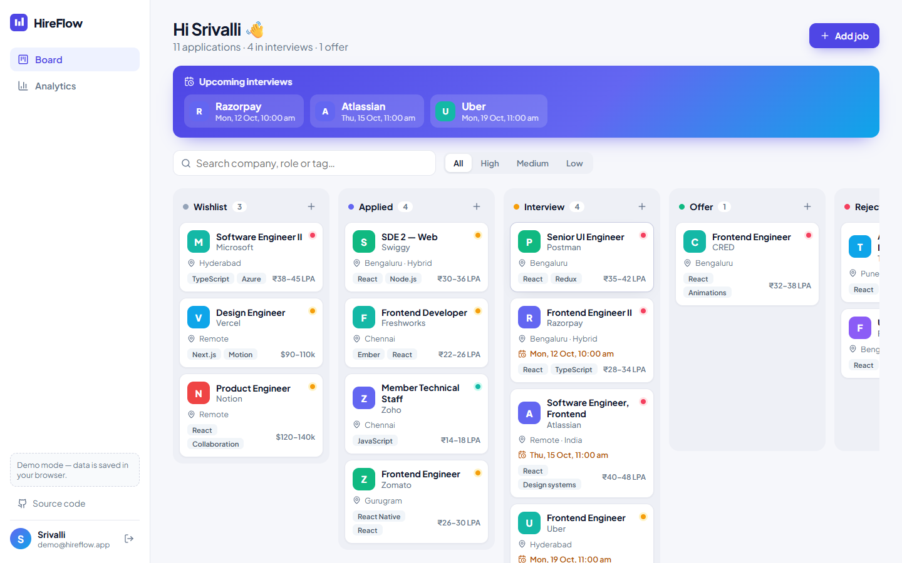
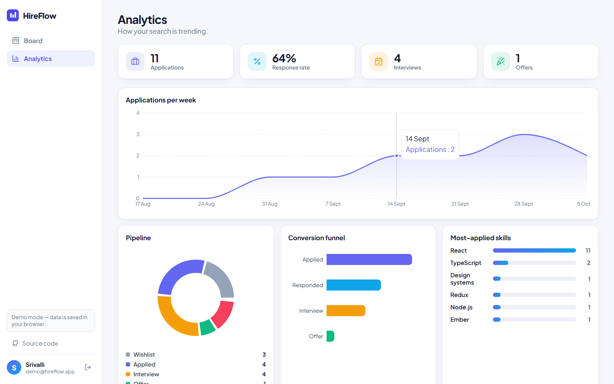
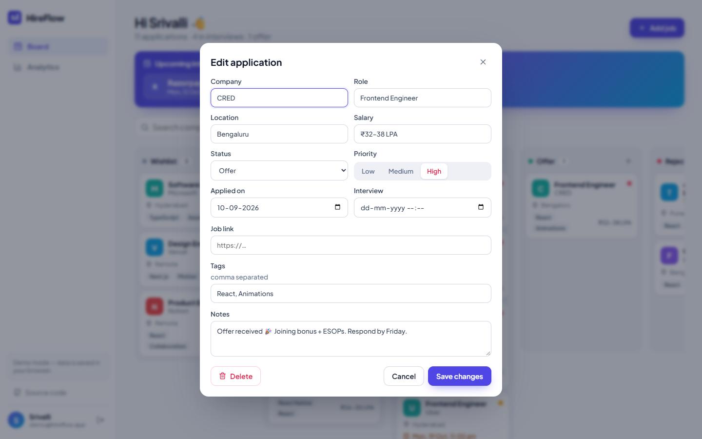

# 📊 HireFlow — Job Application Tracker (MERN)

Track every job application on a **drag-and-drop Kanban board**, never miss an interview, and see what's working with **live analytics**. Full-stack: React + TypeScript + Redux Toolkit on the front, Express + MongoDB + JWT on the back.

**[▶ Live demo](https://srivallihondrede2401-sudo.github.io/hireflow/)** — the demo account is pre-filled, just hit *Log in*. (The static demo stores data in your browser; point the client at the API to use MongoDB.)



## Features

**Board**
- Five-stage pipeline — Wishlist → Applied → Interview → Offer → Rejected
- Drag & drop between and within columns (`@dnd-kit`) with **optimistic updates** and rollback on API failure
- Search by company / role / tag, filter by priority
- Upcoming-interviews strip, priority dots, salary, tags, notes and job links on every card

**Analytics**
- KPIs: applications, response rate, interviews, offers
- Applications-per-week area chart, pipeline donut, conversion funnel, most-applied skills (`recharts`)

**Auth & API**
- Register / log in with **bcrypt-hashed passwords** and **JWT** sessions
- REST API with **Zod validation**, per-user data isolation, MongoDB aggregation for stats
- Central error handling (validation → 400, duplicate email → 409, auth → 401)

| Analytics | Edit an application |
|---|---|
|  |  |

## Tech stack

| Client | Server |
|---|---|
| React 18, TypeScript, Vite | Node.js, Express |
| Redux Toolkit (slices, async thunks, memoised selectors) | MongoDB + Mongoose |
| React Router, @dnd-kit, Recharts, lucide-react | JWT, bcryptjs, Zod, CORS |

## Architecture

```
hireflow/
├─ client/
│  └─ src/
│     ├─ app/store.ts              # RTK store + typed hooks, session persistence
│     ├─ features/auth/authSlice   # login / register thunks
│     ├─ features/jobs/jobsSlice   # CRUD thunks, optimistic moveJob, selectors
│     ├─ lib/api.ts                # one Api interface → HttpApi (Express) | LocalApi (demo)
│     ├─ components/               # Board (dnd-kit), JobCard, JobModal, Layout
│     └─ pages/                    # Login, Board, Analytics
└─ server/
   └─ src/
      ├─ models/                   # User (bcrypt hooks), Job
      ├─ routes/auth.js            # POST /register, POST /login, GET /me
      ├─ routes/jobs.js            # CRUD, PATCH /:id/move, GET /stats
      └─ middleware/               # requireAuth (JWT), error handler
```

### REST API

| Method | Endpoint | Description |
|---|---|---|
| `POST` | `/api/auth/register` | Create account → `{ user, token }` |
| `POST` | `/api/auth/login` | Log in → `{ user, token }` |
| `GET` | `/api/auth/me` | Current user |
| `GET` | `/api/jobs?status=&q=` | List / search jobs |
| `POST` | `/api/jobs` | Create a job |
| `PATCH` | `/api/jobs/:id` | Update a job |
| `PATCH` | `/api/jobs/:id/move` | Move between columns `{ status, order }` |
| `DELETE` | `/api/jobs/:id` | Delete a job |
| `GET` | `/api/jobs/stats` | Counts per status + applications per week |

## Run locally

```bash
# 1. API (needs MongoDB running locally or an Atlas URI)
cd server
cp .env.example .env        # set MONGODB_URI and JWT_SECRET
npm install && npm run dev  # http://localhost:4000

# 2. Client
cd ../client
echo "VITE_API_URL=http://localhost:4000" > .env
npm install && npm run dev  # http://localhost:5173
```

Leave `VITE_API_URL` empty to run the client on its own in demo mode.

---

Built by **[Hondrede Srivalli](https://github.com/srivallihondrede2401-sudo)**
